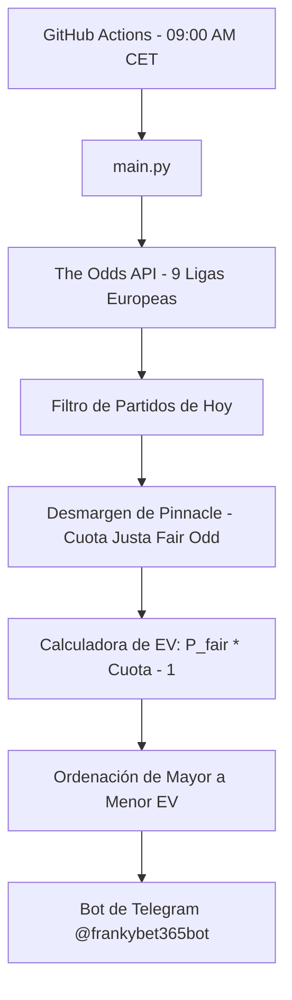

# ⚽ Bot de Apuestas con Valor Esperado (+EV)

Sistema autónomo desarrollado en Python para escanear partidos de fútbol diarios, calcular la probabilidad real del mercado mediante el desmargen de **Pinnacle** (la casa de apuestas más eficiente del mundo) y detectar valor esperado positivo (**+EV**) para apostar en **Bet365** y casas recreativas.

El bot se ejecuta automáticamente cada mañana a las **09:00 AM (hora de España peninsular)** mediante **GitHub Actions** y envía los resultados directamente a tu móvil por **Telegram**.

---

## 🚀 Arquitectura y Funcionamiento



### 1. Ligas Analizadas
1. 🇪🇸 LaLiga EA Sports (`soccer_spain_la_liga`)
2. 🇪🇸 LaLiga Hypermotion (`soccer_spain_segunda_division`)
3. 🇬🇧 Premier League (`soccer_epl`)
4. 🇮🇹 Serie A (`soccer_italy_serie_a`)
5. 🇩🇪 Bundesliga (`soccer_germany_bundesliga`)
6. 🇫🇷 Ligue 1 (`soccer_france_ligue_one`)
7. 🇬🇧 Championship (`soccer_efl_champ`)
8. 🇳🇱 Eredivisie (`soccer_netherlands_eredivisie`)
9. 🇵🇹 Liga Portugal (`soccer_portugal_primeira_liga`)

### 2. Modelo Matemático (+EV y Kelly)
1. **Desmargen Proporcional (Multiplicative Devigging):**
   Para un partido con cuotas de Pinnacle $O_1, O_X, O_2$:
   $$p_i = \frac{1}{O_i}, \quad S = p_1 + p_X + p_2$$
   $$P_{\text{fair}, i} = \frac{p_i}{S}, \quad O_{\text{fair}, i} = \frac{1}{P_{\text{fair}, i}}$$
2. **Valor Esperado (+EV):**
   Para la cuota ofrecida en la casa recreativa $O_{\text{ofrecida}}$:
   $$\text{EV} = (P_{\text{fair}} \times O_{\text{ofrecida}}) - 1$$
   Si $\text{EV} > 0$, la apuesta tiene esperanza matemática positiva a largo plazo.
3. **Gestión de Stake (Criterio de Kelly Fraccional):**
   Utiliza *Quarter Kelly (25%)* para una gestión prudente del bankroll (máx 3.5% por apuesta).

---

## 🛠️ Configuración Rápida

### Paso 1: Conectar tu Telegram (Autodetección de Chat ID)
> **Importante:** Telegram no permite que un bot se envíe mensajes a sí mismo usando su nombre de usuario (`frankybet365bot`). Necesitas vincular tu ID numérico personal.

1. Abre Telegram y busca a tu bot: [https://t.me/frankybet365bot](https://t.me/frankybet365bot)
2. Pulsa el botón **INICIAR** (Start) o envíale un mensaje cualquiera (ej. `hola`).
3. En tu terminal ejecuta el autodetector:
   ```bash
   python3 detect_chat_id.py
   ```
4. El script detectará tu mensaje al instante, guardará tu Chat ID numérico en `.env` y te enviará un mensaje de bienvenida de prueba.

---

### Paso 2: Prueba Local
Ejecutar un escaneo completo de prueba:
```bash
# Probar el escaneo sin enviar a Telegram
python3 main.py --dry-run

# Probar solo una liga específica
python3 main.py --dry-run --league soccer_spain_segunda_division

# Ejecutar el escaneo real y recibir el informe en Telegram
python3 main.py
```

---

## ☁️ Automatización Gratuita en GitHub Actions

Para que el bot se ejecute **totalmente solo cada mañana a las 09:00 AM** (sin necesidad de tener el ordenador encendido):

1. **Crea un repositorio en GitHub:**
   * Entra en [github.com/new](https://github.com/new) y crea un repositorio (público o privado).
2. **Sube el código:**
   ```bash
   git add .
   git commit -m "Initial commit - Bot de Apuestas con Valor (+EV)"
   git branch -M main
   git remote add origin https://github.com/TU_USUARIO/TU_REPOSITORIO.git
   git push -u origin main
   ```
3. **Configura los Secrets en GitHub:**
   * En tu repositorio de GitHub, ve a **Settings** > **Secrets and variables** > **Actions** > **New repository secret**.
   * Añade estos 3 secretos:
     * `ODDS_API_KEY`: `972b3c362634fcd8774a38e5b93ffd6f`
     * `TELEGRAM_BOT_TOKEN`: `9219638473:AAEYp5u89YbG2TjuyKeXrCJJIHvlSwqCLJo`
     * `TELEGRAM_CHAT_ID`: El ID numérico que obtuviste en el Paso 1.
4. **¡Listo!**
   * En la pestaña **Actions** de tu repositorio verás el flujo `Daily Betting Value Scanner (+EV)`.
   * Se ejecutará automáticamente todos los días a las **09:00 AM CET (08:00 UTC)**.
   * También puedes pulsar **Run workflow** en cualquier momento para lanzarlo bajo demanda.

---

## 🧪 Ejecutar Tests Unitarios
Para verificar la lógica matemática y de negocio:
```bash
python3 -m unittest test_bot.py
```
